<h1 data-importer="text" align="center">hey there 👋</h1>

###

  
  
  
  
  
  

###

  

###

<h3 data-importer="text" align="center">A passionate frontend developer | UnderGraduate BIT (UOM)</h3>

###

<h3 data-importer="text" align="left">👩‍💻  About Me</h3>

###

 

- 🔭 I’m currently working on [Ella-Pass](https://nashath53.github.io/Ella-pass-tourism-platform/)

- 🌱 I’m currently learning **React.js,Node.js,Advanced JavaScript,REST API and Git and collaborative developments**

- 🤝 I’m looking for help with [Ella-Pass]((https://github.com/Nashath53/Ella-pass-tourism-platform))

- 👨‍💻 All of my projects are available at [Nashath.dev-portfolio](https://nashath-portfolio.pages.dev/)

- 📫 How to reach me **nashath.dev@gmail.com**

###

<h3 data-importer="text" align="left">🔗 Tech Stack</h3>

###

  
  
  
  
  
  
  

###

<h3 data-importer="text" align="left">🛠 Language and tools</h3>

###

  
  
  
  
  
  
  
  
  
  
  
  
  
  
  
  
  
  
  
  
  
  
  
  
  
  
  
  
  
  
  
  
  

<h3 align="left"> 🏆 Achievements</h3>

###

<h3 data-importer="text" align="left">🔥   My Stats :</h3>

###

  

###

  
  

###

